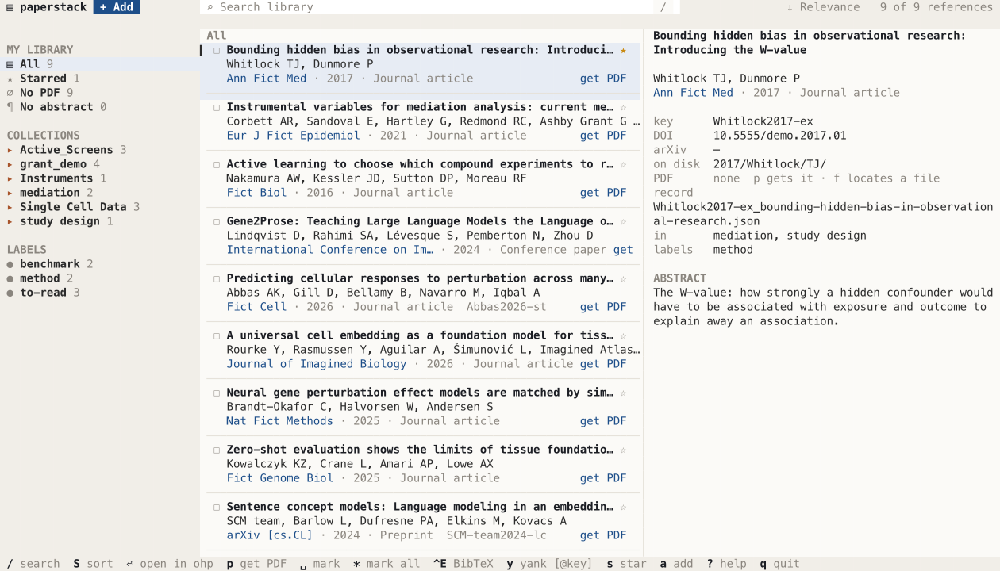

# paperstack

A library of papers in the terminal: PDFs and their references, kept in a
folder, as in Dropbox, that an AI agent can read as easily as you can.
PDFs are presented with [ohp](https://github.com/YPARK/ohp).

Early days. `paperstack init --demo` makes a library of nine papers to try
it with.



`--theme dark`, or `PAPERSTACK_THEME=dark`, draws it in the terminal's own
colours instead.

## Install

Rust 1.92 or later, and `ohp` on the `PATH` to open PDFs:

```sh
cargo install --git https://github.com/YPARK/paperstack
```

Pure Rust: nothing in C is compiled, as for ohp. HTTPS is rustls with
RustCrypto's algorithms, which are not yet audited.

## Use

```sh
paperstack init --demo                 # a library at ~/Dropbox/paperstack, with papers to try
paperstack                             # browse it
paperstack find perturbation 'author:Huber'
paperstack find 'folder:"Single Cell Data" -label:benchmark' --sort year --bib > refs.bib
paperstack get Ahlmann-Eltze2025-pb --json
```

The library is `--library`, else `$PAPERSTACK_LIBRARY`, else
`~/Dropbox/paperstack`.

## Adding papers

```sh
paperstack add 10.1038/s41586-020-2649-2            # a DOI
paperstack add arXiv:2412.08821 'PMID: 28693043'    # an arXiv id, a PMID, a PMCID
paperstack add https://onlinelibrary.wiley.com/doi/full/10.1002/sim.7400
paperstack add ~/Downloads/paper.pdf --folder mediation
paperstack add 'Array programming with NumPy'       # a title, if just one paper has it
paperstack inbox                                    # file what was saved to inbox/
echo 10.7554/eLife.10047 | paperstack add -         # one a line, as an agent would
```

`a` in the browser does the same, into the folder or label picked on the
left, with what is on the clipboard filled in.

Publishers' pages mostly turn away programs that are not browsers, so
paperstack reads what it needs from the registries instead: the paper's
record from doi.org, arXiv or PubMed, and from OpenAlex an abstract the
record lacks and where open copies of the PDF are. Most publishers'
addresses carry the DOI, or an id that leads to it, as ScienceDirect's PII;
a page that does not is read for its `citation_doi`, if it can be. A
preprint since published is filed as what it was published as, its arXiv
id kept. A PDF behind a paywall is downloaded in the browser, as before,
and saved to `inbox/`.

A PDF is told by the DOI in its metadata or on its first page, or arXiv's
stamp down its margin, taken only where the title it leads to is on the
page, with one of its authors: first pages name other papers' DOIs too.
Without one, the first lines are searched for in Crossref, OpenAlex and
arXiv, and the same check made. Given a title alone, paperstack adds the
paper only if one paper has just that title: registries hold copies of
famous papers reposted under other DOIs, so where several do it lists them,
and adds the one then given by its id.

Registries are asked as paperstack, with an address to write to, as they
ask: `--email`, `$PAPERSTACK_EMAIL`, or git's `user.email`.

| Key | |
|---|---|
| `j` / `k`, arrows | move; on the left, change shelf |
| `h` / `l`, `tab` | switch between shelves and papers |
| `/` | search, as below; `esc` clears |
| `S` | sort by relevance, date added, year, first author or title |
| `enter`, `o` | open the PDF in ohp; quit ohp to come back |
| `space` | mark a paper; `*` marks all shown, or unmarks them; `esc` unmarks all |
| `c` | BibTeX of the papers marked, or the one picked |
| `y` | copy `[@key; @key]` to the clipboard |
| `s` | star, written to the paper's record |
| `a` | add a paper, as `paperstack add` does |
| `r` | read again papers added meanwhile, as by `paperstack serve` |
| `q` | quit |

## From the browser

PDFs behind a paywall, or a publisher's bot check, are had only in the
browser, signed in as you. Two ways bring them in:

```sh
paperstack watch ~/Downloads        # file PDFs as they come into inbox/ and ~/Downloads
paperstack serve --watch ~/Downloads   # the same, and the browser extension's papers
```

Only PDFs that come into a folder after it is watched are filed, but in the
inbox, and a PDF filed is taken out of the inbox; out of other folders only
with `--take`.

`serve` listens at `127.0.0.1:8765` for the extension in `extension/`,
which is loaded into Chrome from this checkout, not the Web Store:
`chrome://extensions`, turn on Developer mode, Load unpacked, pick the
`extension` folder. Its button, on a paper's page, reads the page's DOI and
`citation_*` tags, fetches the PDF there, with your institution's access,
and sends both to `serve`, which files the paper if the PDF is the page's
paper, or says it is not, as a supplement would be. The badge says how it
went: `✓`, `✓·` without a PDF, `!` and a notification of why not. The
server answers only this machine, and of browsers only paperstack's
extension, whose id the `key` in its manifest fixes as
`kckhjncnkhapnmnjlpjefjamffaecmcf` wherever it is loaded from; others are
let in with `--extension ID`, or with their origin whole, as
`--extension moz-extension://ID`. No page can add papers. Requests are read
by a few threads, so a slow one keeps no other waiting.

To have `serve` run from login on macOS, a LaunchAgent:

```sh
cat > ~/Library/LaunchAgents/com.github.ypark.paperstack.plist <<PLIST
<?xml version="1.0" encoding="UTF-8"?>
<!DOCTYPE plist PUBLIC "-//Apple//DTD PLIST 1.0//EN" "http://www.apple.com/DTDs/PropertyList-1.0.dtd">
<plist version="1.0"><dict>
  <key>Label</key><string>com.github.ypark.paperstack</string>
  <key>ProgramArguments</key><array>
    <string>$HOME/.cargo/bin/paperstack</string><string>serve</string>
    <string>--watch</string><string>$HOME/Downloads</string>
  </array>
  <key>RunAtLoad</key><true/><key>KeepAlive</key><true/>
  <key>StandardOutPath</key><string>/tmp/paperstack.log</string>
  <key>StandardErrorPath</key><string>/tmp/paperstack.log</string>
</dict></plist>
PLIST
launchctl load ~/Library/LaunchAgents/com.github.ypark.paperstack.plist
```

## Searching

The TUI's `/` and `paperstack find` read the same query:

```
perturbation "linear baseline" author:Huber year:2020..2026 folder:"Single Cell Data" -label:benchmark has:pdf
```

Words, and phrases in quotes, are looked for in the title, abstract,
authors, venue, keywords, key and DOI, title first; a word matches the words
it starts, and accents need not be typed. `title:`, `abstract:`, `author:`
and `venue:` look in one of those; `year:` takes a year or a range,
`2020..2026`, `2020..` or `..2020`; `folder:`, `label:`, `key:` and `doi:`
match whole; `has:pdf`, `has:abstract`, `has:doi` and `is:starred` say what a
paper has. A `-` before any of them leaves out what it matches.

`find` lists the papers found best first, or `--sort year|added|author|title`,
`--reverse`, `--limit N`, as a line each, or:

| | |
|---|---|
| `--bib` | BibTeX, as Paperpile writes it |
| `--csl` | CSL JSON, for pandoc's and ohp's `bibliography:` |
| `--keys` | `[@a; @b]`, to cite them |
| `--json` | key, title, authors, year, ids, folders, the files' paths: for agents |
| `--paths` | the PDFs |

## The library

Each paper is filed by year and first author, its PDF and its record side
by side:

```
2025/Ahlmann-Eltze/C/
  Ahlmann-Eltze2025-pb_deep-learning-based-gene-perturbation-effect.pdf
  Ahlmann-Eltze2025-pb_deep-learning-based-gene-perturbation-effect.json
```

The first author's given name names the third folder, or the initials where
only they are known. The file starts with the citation key, Paperpile's
`Surname2025-xy`, which never changes, so `find . -name 'KEY_*'` finds a
paper. The record is CSL JSON, as pandoc and ohp read it, under `csl`, with
the paper's folders, labels and star under `paperstack`. `AGENTS.md`, at the
root, tells an agent how to find papers and cite them.

The index searched is the records, read and kept in memory with the words
of their text, ranked by BM25: a search among 6,000 papers takes a few
milliseconds. Between runs it is cached on the machine, in
`~/Library/Caches/paperstack` (`~/.cache` elsewhere), not in Dropbox, and is
brought up to the records whenever paperstack starts, reading only those
changed, in about a tenth of a second. A database synced between machines
can be corrupted, while a record can at worst be a conflicted copy of
itself, which paperstack names rather than reads.

## License

MIT; see [LICENSE](LICENSE).
